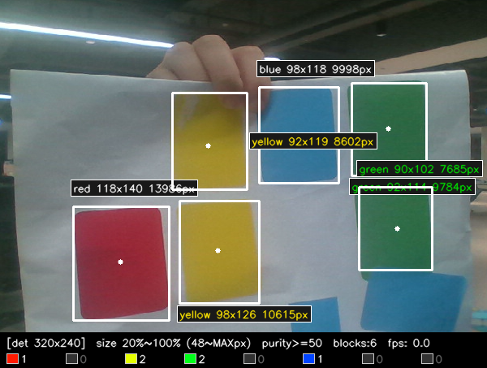
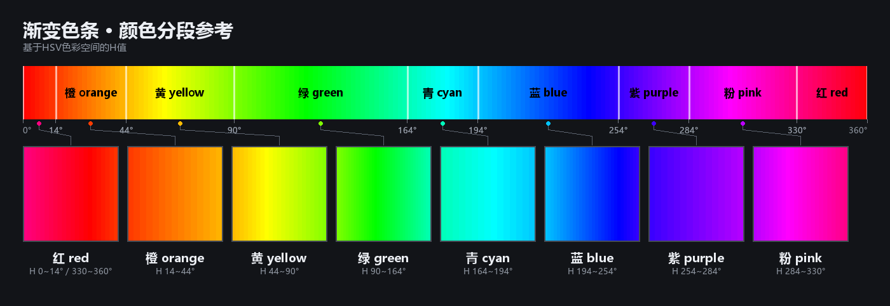

# color-region-detection — 色彩区域检测（3 个可调参数）

基于 HSV 分段的色彩区域检测，界面只保留 3 个可调参数。





## 目录结构

```
color-region-detection/
├── main.py
├── pyproject.toml
├── README.md
├── src/
│   └── color_region_detection/
│       ├── __init__.py
│       ├── __main__.py
│       ├── cli.py
│       ├── colors.py
│       ├── detect.py
│       ├── ui.py
│       ├── colorbar.py      # 渐变色条渲染
│       └── calibrate.py     # 色卡参数标定 / 更新
├── color_bands.png
├── screenshot.png
└── tests/
    ├── test_color_region_detection.py
    ├── make_test_image.py
    ├── make_purity_test.py
    └── data/
        ├── photo_test.png
        ├── purity_test.png
        └── test.png
```

## 依赖

```bash
pip install opencv-python numpy
```

## 运行

```bash
cd color-region-detection

python main.py
python main.py --source tests/data/photo_test.png
python main.py --min-size 10 --max-size 60 --purity 70
python main.py --proc-size 0
python main.py --print-bands
```

安装后可在任意目录运行：

```bash
pip install -e .
python -m color_region_detection
color-region-detection
```

作为库使用：

```python
from color_region_detection.detect import Params, detect_scaled
from color_region_detection.colors import HUE_BANDS, classify

blocks, _ = detect_scaled(frame, Params(min_size_pct=10, purity=60))
# blocks -> [(name, x, y, w, h, area, fill, cx, cy), ...]
```

### 命令行参数

| 参数 | 默认 | 说明 |
|---|---|---|
| `--source` | `0` | 摄像头序号，或图片/视频路径 |
| `--proc-size` | `320x240` | 检测分辨率；只给宽度则按源比例算高度；`0` = 原分辨率 |
| `--min-size` | `20` | 最小尺寸 %（画面短边百分比 1~100） |
| `--max-size` | `100` | 最大尺寸 %（1~100，100 = 不限） |
| `--purity` | `50` | 纯度最低需求 0~100，越大越严 |
| `--min-fill` | `0.35` | 最小填充率 |
| `--keep-bg` | 关 | 保留触达画面边缘的背景块 |
| `--out` | `color_region_detection_result.png` | 图片模式的输出文件 |
| `--no-show` | 关 | 不开窗口 |

### 按键

```
w/W 最小尺寸±     s/S 最大尺寸%±     e/E 纯度±
x 复位            p 保存截图          q 退出
```

## 三个参数

| 旋钮 | 参数 | 默认 | 说明 |
|---|---|---|---|
| `minSize%` | `min_size_pct` | 20 | 最小尺寸 = 画面短边的百分比 1~100 |
| `maxSize%` | `max_size_pct` | 100 | 最大尺寸 = 画面短边的百分比 1~100，100 = 不限 |
| `purity` | `purity` | 50 | 纯度最低需求 0~100，越大越严 |

内部固定值：`min_fill=0.35`、`BLUR=3`（命令行可调 `min-fill`）。

### 纯度 level 的两条约束

```
min_s     = 50 + 1.2 × level          饱和度下限
max_std_v = max(6, 60 - 0.6 × level)  区内明度差上限
```

标定依据（`tests/data/photo_test.png`，室内弱光 + 哑光印刷）：

| 对象 | meanS | sdV |
|---|---|---|
| 真实彩色卡 | 125~176 | 3~22 |
| 背景杂物 | 50~75 | — |
| 阴影球 | 167 | 39 |

`level=50` 落在两者之间。合成纯色图的 S=255，`min_s` 调到 150/200 会使真实照片大面积漏检。

### min_fill 取 0.35 的依据

圆形填充率约 0.785，非凸形状（葫芦）约 0.57，碎片低于 0.3。取 0.6 会误杀葫芦。

## 颜色判定区间

判定区间以 `src/color_region_detection/colors.py` 的 `HUE_BANDS` 为准，`python main.py --print-bands` 打印当前表。

| H 区间（OpenCV 0~179） | 真实色相 | 颜色 |
|---|---|---|
| 0≤H<7 或 165≤H<180 | 0~14° / 330~360° | red 红色 |
| 7~22 | 14~44° | orange 橙色 |
| 22~45 | 44~90° | yellow 黄色 |
| 45~82 | 90~164° | green 绿色 |
| 82~97 | 164~194° | cyan 青色 |
| 97~127 | 194~254° | blue 蓝色 |
| 127~142 | 254~284° | purple 紫色 |
| 142~165 | 284~330° | pink 粉色 |

分界线按实测色相标定（`tests/data/photo_test.png` 绿卡 H≈72、蓝卡 H≈100），非理论色相中点。

只识别这 8 种高纯度彩色，黑/白/灰不参与识别。阴影暗部落进 black/gray，自动被忽略。

`src/color_region_detection/colors.py` 的 `HUE_BANDS` 是全项目唯一真值来源。
换场地 / 换灯 / 换批次色卡后用 `calibrate.py` 重新标定（见下文「更新色卡参数」）。

## 更新色卡参数（重新标定 HUE_BANDS）

`calibrate.py` 拍一张色卡照片就能反推当前光照下的真实色相，重算分界，并重画色条图。

```bash
python src/color_region_detection/calibrate.py                      # 默认图，产物到桌面
python src/color_region_detection/calibrate.py --source <色卡照片>   # 换一张照片
python src/color_region_detection/calibrate.py --labels yellow,cyan,green,red
python src/color_region_detection/calibrate.py --set green=49:81    # 手动锁定某色
python src/color_region_detection/calibrate.py --apply              # 写回 colors.py + 重画 color_bands.png
```

装成包后也可以 `python -m color_region_detection.calibrate`。

流程：色相峰定位色卡（相邻异色卡不粘连） → 逐卡测主导色相 / 饱和度 / 明度
→ 实测色相当作该颜色中心，未测颜色沿用当前中心 → 新分界 = 相邻中心中点
→ 结果必然连续、覆盖 0~180、无重叠无缝隙。

产物（默认在桌面）：`color_bands_new.png`（新色条）、`color_bands_compare.png`（原图 vs 新图）、
`card_params_compare.png`（色卡实测标注）、`card_params_report.md`、`card_params_new.json`。

`--apply` 会改 `src/color_region_detection/colors.py` 的 `HUE_BANDS` 并重画
`color_bands.png`；改完跑一遍 `python tests/test_color_region_detection.py` 确认分段表仍合法。

色条图单独重画：

```bash
python src/color_region_detection/colorbar.py --out color_bands.png
```

## 处理流程

```
摄像头帧
  → 降采样到 --proc-size（默认 320x240）
  → 中值滤波去噪
  → BGR2HSV
  → 逐像素颜色分类（8 种彩色，其余标 0）
  → 每种颜色各跑一次连通域
  → 背景抑制（触达 ≥3 条画面边界的连通域丢弃）
  → 大小过滤（边长区间）
  → 区内纯度过滤（meanS 与 sdV）
  → 画外接框 + 颜色名 + 尺寸 + 面积
```

外接矩形与形状无关，球、葫芦等任意形状都能框住。尺寸阈值以面积与填充率为主。

## 实现约束

- 每种颜色必须单独跑一次连通域。`connectedComponents` 把所有非零像素当前景，
  相邻的不同色区域会合并成一个连通域（实测值 3 与 7 相邻 → 合成 1 个域），
  8 次调用无法合并为 1 次。
- 局部方差须走 uint16 预乘路径。`boxFilter(V, -1, ...)` 会让 `V*V` 在 uint8 下溢出，
  实测标准差最大偏差 68。正确做法是 `uint16` 预乘后转 CV_32F，比先转 float32 快 23~36%。
- bool 数组不能直接喂 `connectedComponents`，须转 uint8。`bool` 比较结果本就是 1 字节，
  用 `.view(np.uint8)` 零拷贝即可。
- 去噪不能用均值滤波，会把区域边缘抹成灰色，实测尺寸虚胖 3~5px。用中值滤波。
- 4 邻域比 8 邻域慢 9%。
- 降分辨率与省略形态学是实测有效的提速手段。

## 测试

```bash
python tests/test_color_region_detection.py
```

覆盖：

- 标量分类与向量化分类逐点一致
- 黑/白/灰不出现在任何结果中
- 颜色判定区间连续、无重叠、覆盖 0~179
- 实测色相落到正确区间（弱光绿卡 H≈72 → green，蓝卡 H≈100 → blue）
- 三个参数各自单调：放宽则检出增加，收紧则检出减少
- 大小组与纯度组都能拦截干扰物，合成干扰物图只剩 4 个目标
- 真实照片 7 张色卡中 6 张命中（第 7 张 proc 尺寸 34x25px，低于 20% 阈值，
  放宽到 `min-size 10` 可全部命中）
- 非凸形状（葫芦，fill≈0.68）不被误杀
- 构造后自动 sanitize，越界值被夹取
- 统计失败返回 `None`，判为不合格
- 滑动条数值转换、按键与滑条双向同步、GUI 路径烟雾测试
- 分段表连续、无重叠、覆盖 0~179

重新生成测试图：

```bash
python tests/make_test_image.py
python tests/make_purity_test.py
```

## 性能（本机 x86）

| 检测分辨率 | 耗时 | FPS |
|---|---|---|
| 240x320 | 1.82 ms | 549 |
| 320x240（默认） | 2.34 ms | 428 |
| 480x326 | 4.44 ms | 225 |

## 已知限制

1. 弱光下色相偏移：深绿在低亮度下 H 往青蓝方向漂。框的位置正确，颜色名可能不准。
2. 明暗渐变：球与苹果的暗部判为 black/gray 被忽略，区内 `sdV` 超过阈值直接判为不纯。
3. 同色物体粘连：相邻同色物体会连成一个连通域，需距离变换 + 分水岭分离。
4. 被画面边缘裁切的物体：`ignore_bg` 会丢弃触达 ≥3 条边界的连通域，可用 `--keep-bg` 关闭。
5. 框上文字是 ASCII：OpenCV 的 Hershey 字体不支持中文，中文色名只打印在控制台。
